# Admin Hub — Batch 1 report (hub engine moves into /admin)

Plan: [`BATCH_1_PLAN.md`](./BATCH_1_PLAN.md). Branch `admin-hub-batch-1`, PR base `preview-hub-batch-7`.

## Outcome

With `ADMIN_HUB_ENABLED=true` (and `FREE_PREVIEW_FLOW_ENABLED`), a preview email link `/preview/{token}/…` sets a signed
`ks_hub` cookie and 303s to `/admin`, which renders the new hub shell (sidebar, red setup card, private label, Leave
preview; mobile top bar and 3-tab bar) around the existing hub views. The token never appears in `/admin` HTML. With the
flag off nothing changes: the real-stack flag-off check confirms no bridge, `/admin` 200 with no `ks_hub` cookie, no
`X-Robots-Tag` and no `admin-hub` markup, and `/admin/hub` 404.

No migration. `PREVIEW_HUB_ENABLED` untouched. `ADMIN_HUB_ENABLED` not set on Vercel.

## Checks

| Check | Result |
| --- | --- |
| `npm test` | 5906/5906 (the known `financialEndpoints` MANAGER timeout flaked once in the full run; passes alone) |
| `npm run typecheck` | 0 errors |
| `npm run claims:check` | pass |
| `npm run build` | pass |
| `npm run test:admin-hub-real` | 8/8 Playwright tests + flag-off check, axe (serious/critical) clean on `.admin-hub`, no horizontal scroll at every width |

Real-stack coverage (`scripts/admin-hub-real.spec.ts`, local embedded Postgres only):
- REQUESTED and READY email links land on `/admin` with the shell; private headers; cookie `HttpOnly; Secure;
  SameSite=Lax; Path=/`; token absent from response HTML and live DOM.
- Every READY sub-route maps per spec §2.2 (`/website`, `?view=booking`, `/changes`, `/details`, `/messages?draft=`,
  `/overview`).
- `/api/admin-hub/messages` works from the cookie (request client and in-page `fetch`); cross-origin POST → 403;
  `/api/admin/bookings|clients|team|barbershop-settings` with only `ks_hub` → 401/403.
- REJECTED and unknown tokens → 404, no cookie. EXPIRED → cookie + expired state on `/admin`.
- Operator: `op` cookie, banner, "Viewing as KERSIVO"; op cookie without an operator session is dropped and `/admin`
  falls back to the normal admin.
- Leave preview clears the cookie and goes home; `/admin` is the normal admin afterwards.
- Signed-in owner of a converted, not-yet-live preview sees the hub launch phase.

Regression (unit): `adminMode.test.ts` asserts paid, Starter, direct-subscribe (no preview request), member and
signed-out users resolve to `full` (or `null` with the flag off), so they keep today's admin.

## Screenshots vs mockups

All in `docs/admin-hub/screens/batch-1/`. Captures are full-page, so on mobile the fixed bottom tab bar appears where
the viewport ended rather than at the bottom of the image.

### Overview — desktop

| Batch 1 (READY, 1440) | Mockup 01 |
| --- | --- |
| 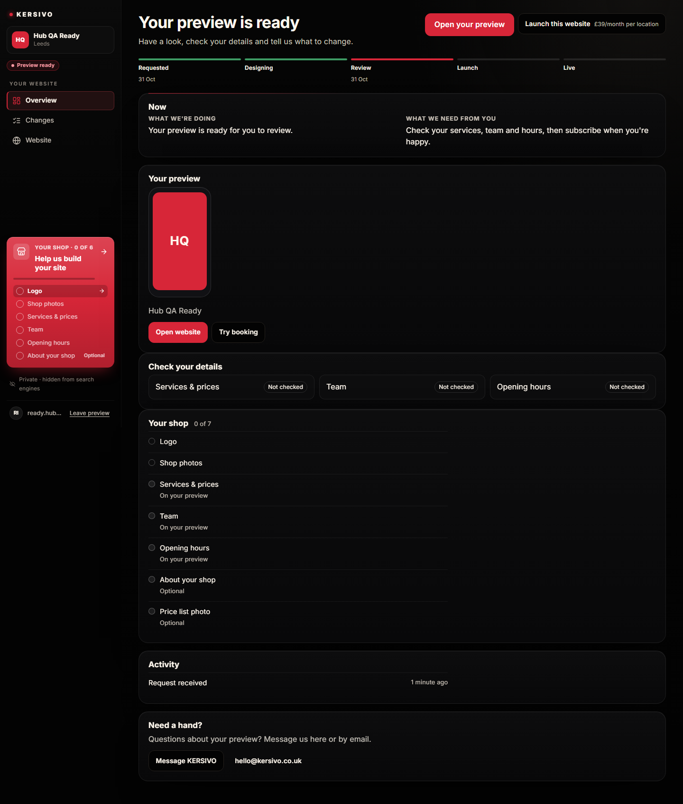 | 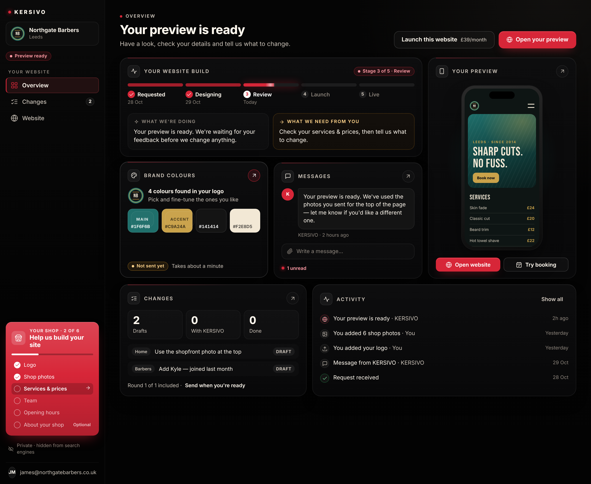 |

Also: `requested-overview-{390,768,1280,1440}.png`, `ready-overview-{768,1280}.png`.

### Overview — mobile

| Batch 1 (READY, 390) | Mockup 04 |
| --- | --- |
| 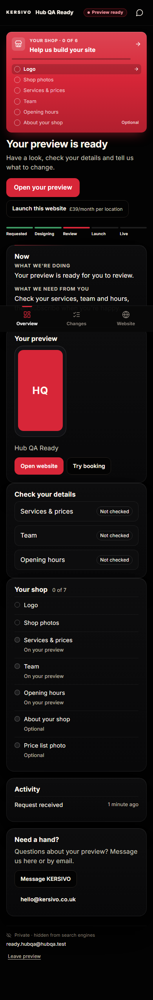 | 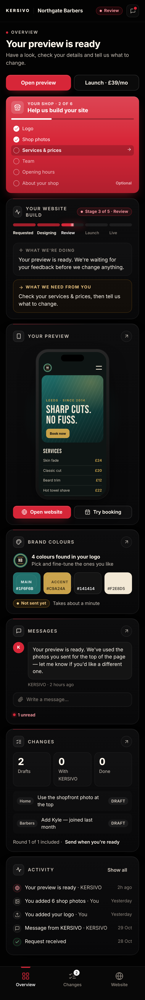 |

### Website

| Batch 1 (1440) | Mockup 03 |
| --- | --- |
| 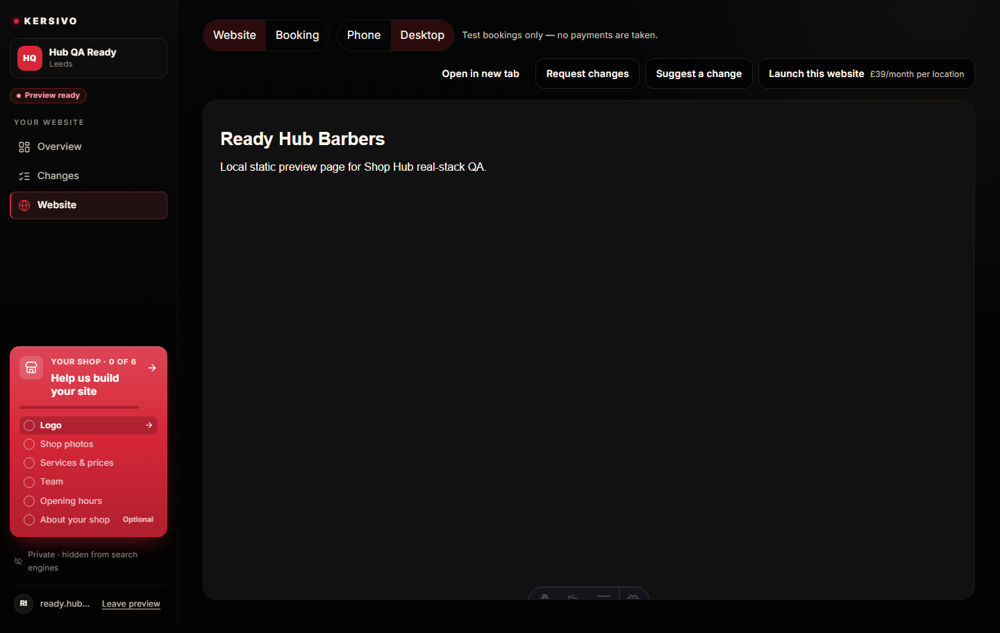 | 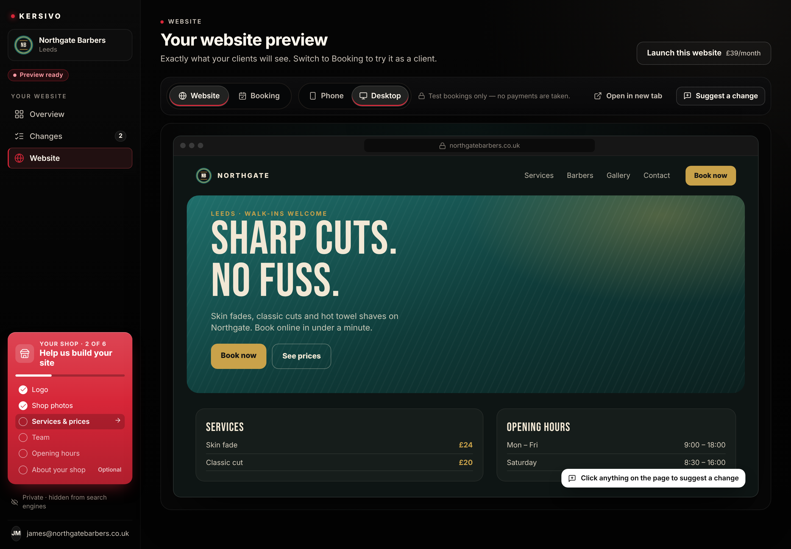 |

| Batch 1 (390) | Mockup 05 |
| --- | --- |
| 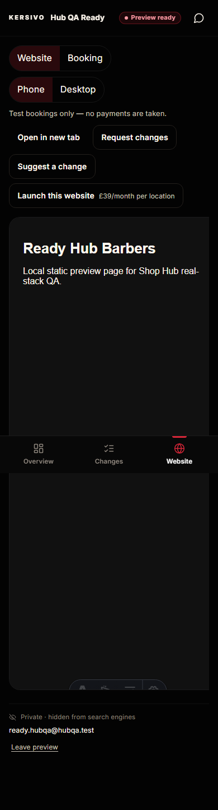 | 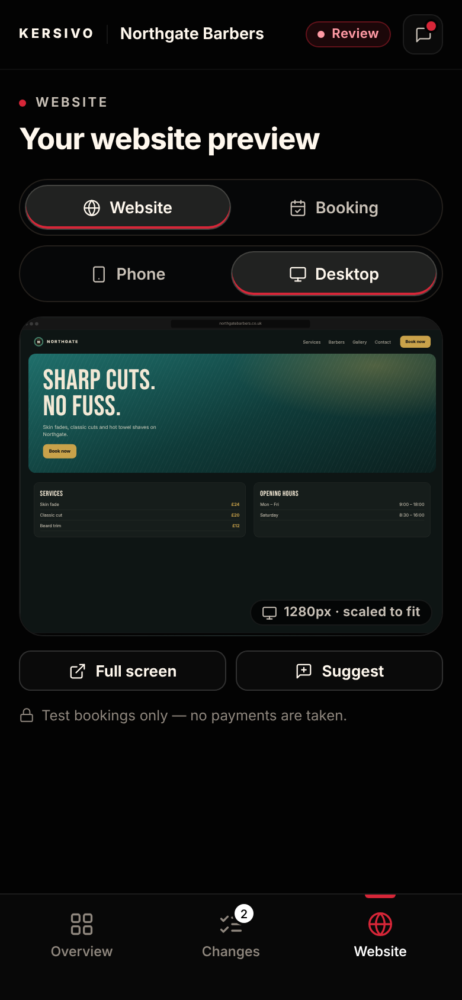 |

Also: `ready-website-{768,1280}.png`.

### Setup card

| Batch 1 sidebar card (REQUESTED, 1440) | Mockup 06 |
| --- | --- |
| 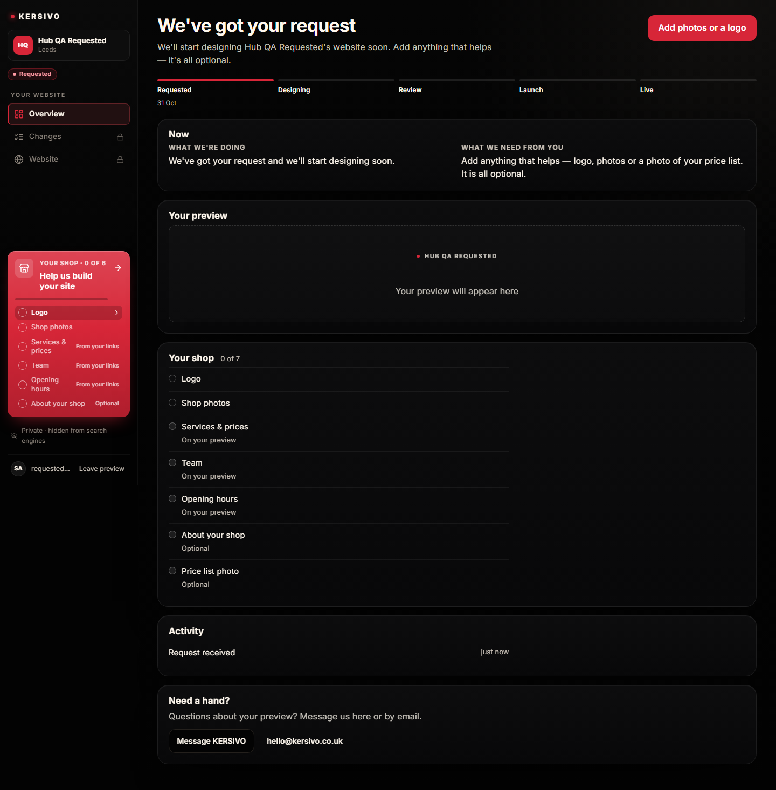 | 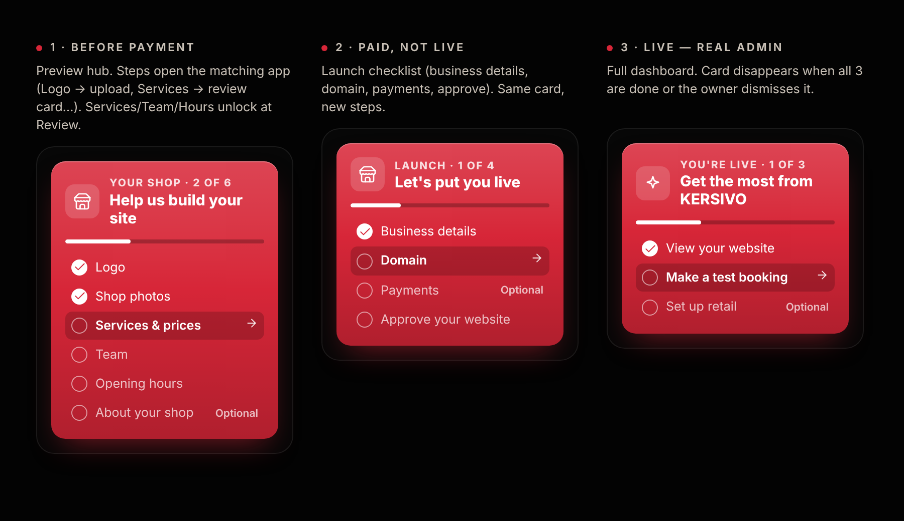 |

`ready-setup-{390,1440}.png` shows `?app=setup` (the old details view, full width until Batch 2's app windows).

### Messages

| Batch 1 (1440) | Mockup 08 |
| --- | --- |
| 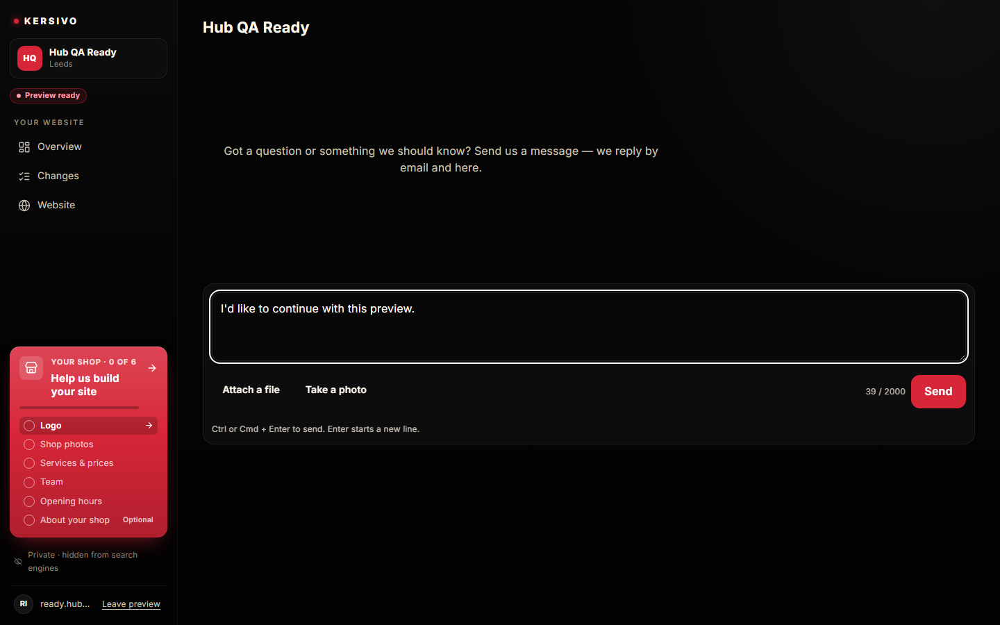 | 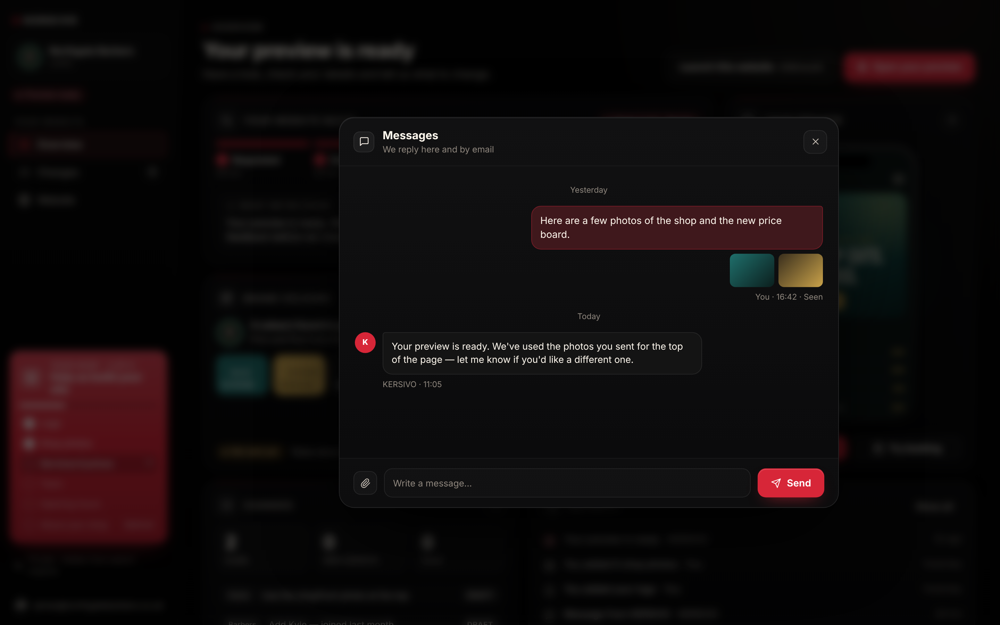 |

### Screens without a mockup

- Changes: `ready-changes-{390,1440}.png`
- Expired: `expired-overview-{390,1440}.png`
- Operator: `operator-overview-{390,1440}.png`
- Converted owner, launch phase: `converted-launch-{390,1440}.png`

## Differences from mockup

Expected for Batch 1 (the brief says to render the existing hub views inside the new shell):
1. Overview body is today's `HubOverview` (stacked cards), not the bento grid (build card, brand colours, messages,
   changes, activity, phone preview). No "OVERVIEW" eyebrow.
2. Website body is today's `HubWebsiteView` toolbar and frame, not the mockup's eyebrow, title and single toolbar row.
3. Messages and setup open full width in the main column, not as app windows.
4. Brand colours card and `?app=colours` are not built (later batch); `colours` maps to the setup view.

Shell differences:
5. Desktop sidebar has no Messages entry, matching the mockup; Messages is reached from the overview help card and the
   mobile top-bar icon.
6. On mobile the setup card sits above the page heading; in mockup 04 it sits below the heading and actions. Moving it
   needs the heading to leave `HubOverview`, which is Batch 2+ work.
7. Setup card: the checklist is passed as children of `AdminLaunchCtaButton`, so the whole card is one link to
   `?app=setup`; individual rows are not separate links yet. The card's accessible name is its visible content (an
   `aria-label` override failed WCAG 2.5.3, label-in-name). `ariaLabel` on `AdminLaunchCtaButton` is now optional;
   existing callers still pass it.
8. Long owner emails are truncated with an ellipsis in the account row.
9. Stage pill on the review stage reads "Preview ready" (mockup wording) instead of the old hub's "Review".
10. In the website captures the faint toolbar at the bottom of the frame is Astro's dev toolbar inside the local QA
    preview page (iframe), not part of the shell; it does not exist in production builds.

## Open questions

1. **Operator precedence.** An op cookie plus a live operator session wins over the operator's own shop session, so
   operators who also own a shop can still view the hub. Without this, the session would always win (spec §2.1). Please
   confirm.
2. **Converted, not-live owners.** With the flag on, a signed-in owner whose shop is a preview draft in the launch
   stage gets the hub launch phase on `/admin` instead of today's full admin plus `/admin/preview-launch`. I read this
   as the spec's intent, but it is a visible change for those owners.
3. **Headers on /admin.** `noindex`/`no-referrer`/`private, no-store` are set on `/admin` only when the flag is on
   (flag off must stay byte-for-byte). Turning them on for everyone is a one-line change if wanted.
4. **Expired status code.** The old token hub answered 410 for expired previews; `/admin` answers 200 with the expired
   state so the owner can still message us. OK?
