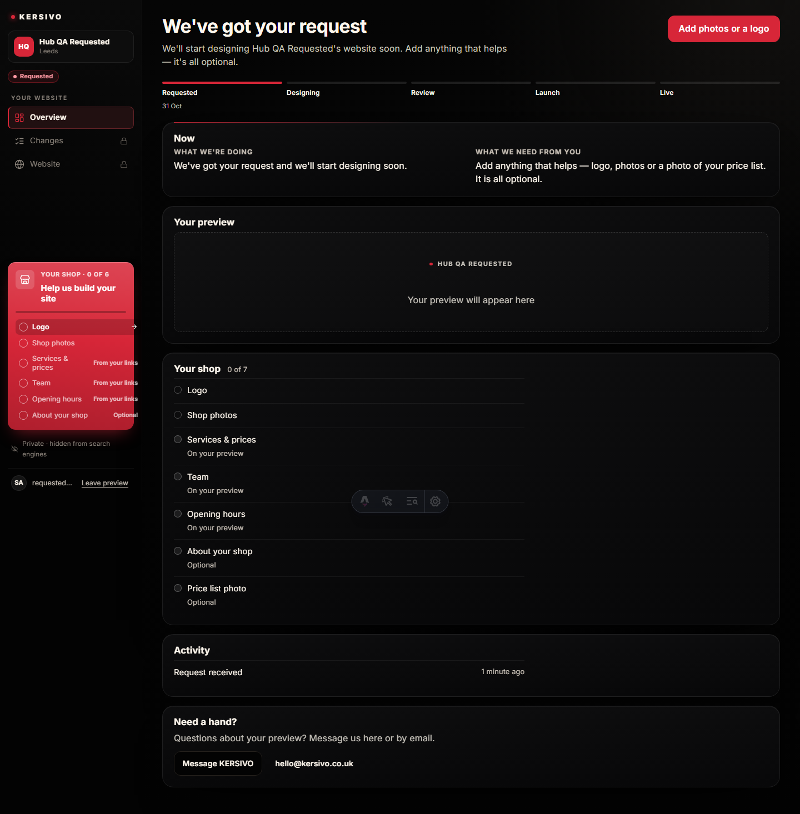
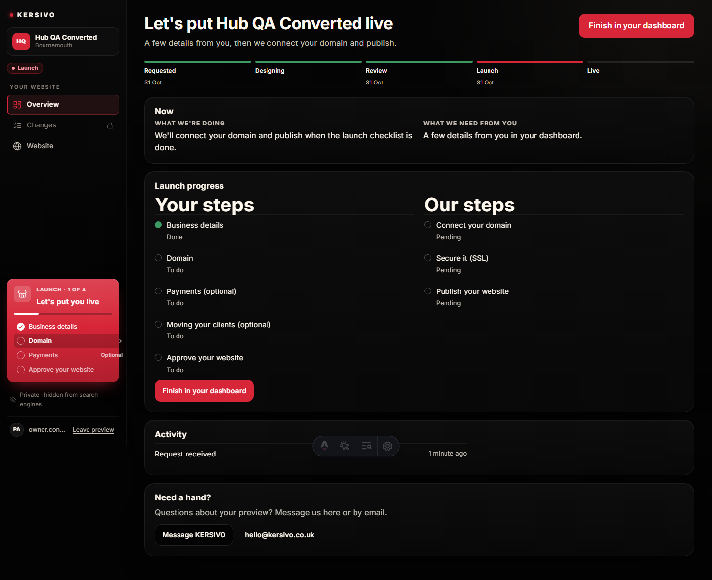
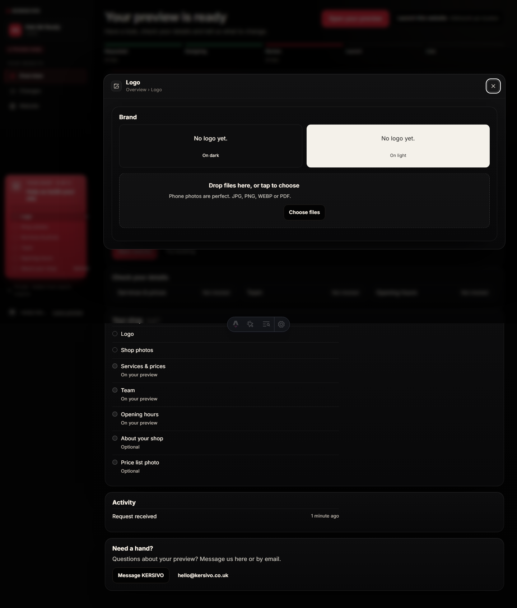
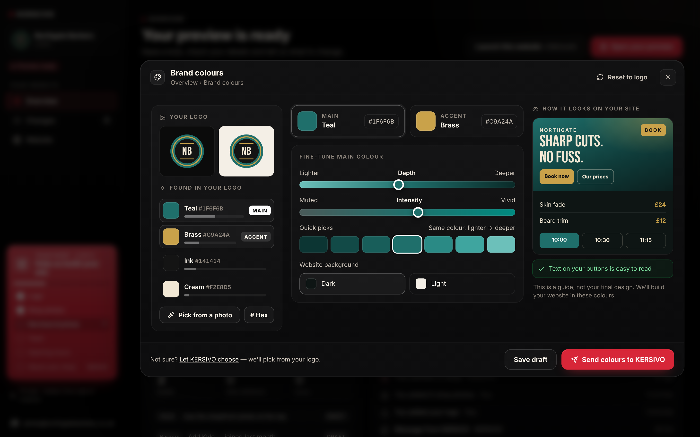
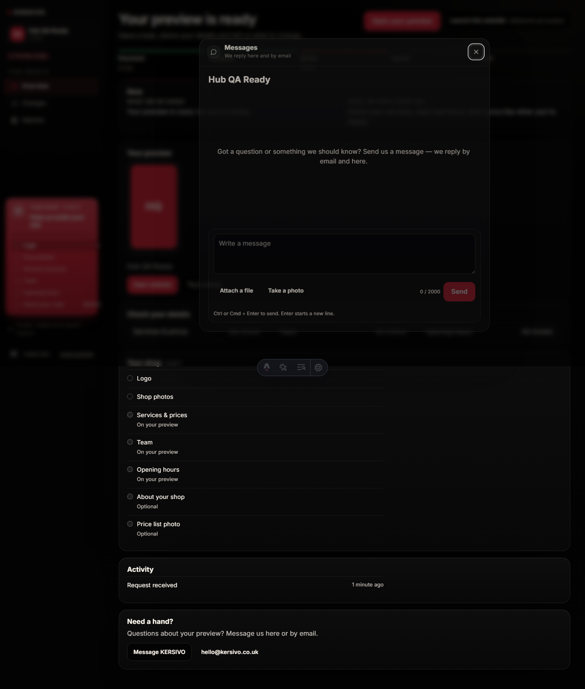

# Admin Hub — Batch 2 report (red card + app windows)

Plan: [`BATCH_2_PLAN.md`](./BATCH_2_PLAN.md). Branch `admin-hub-batch-2`, PR base `admin-hub-batch-1` (#182).

## Outcome

`?app=` now opens a centred desktop window (max 1120px; messages 720px) or a mobile bottom sheet over the current
section. Title bar, close, focus trap, Esc, one history entry per click-open, focus return, `aria-modal` +
`aria-labelledby`. View Transitions when supported and motion is allowed; otherwise 160ms fade/scale. Apps lazy-load.

The red setup card is no longer one link: every row is its own `<a href="/admin?app=…">`. Phase 1 (preview stages) and
phase 2 (launch) render; phase 3 is a typed stub only.

Shop-detail apps reuse the existing islands (restyle / focus only): logo, photos + price list, services / team / hours,
about, setup, activity. Phase 2 rows reuse `HubLaunchChecklist` for a signed-in owner of the draft shop.

`ADMIN_HUB_ENABLED` stays off on Vercel. `PREVIEW_HUB_ENABLED` is not set. No migration.

## Checks

| Check | Result |
| --- | --- |
| `npm test` | 5922 passed (the known `financialEndpoints` MANAGER timeout flaked once in the full run; passes alone) |
| `npm run typecheck` | 0 errors |
| `npm run claims:check` | pass |
| `npm run build` | pass |
| `npm run test:admin-hub-real` | 11/11 Playwright tests + flag-off check; axe (serious/critical) clean on each app at 390 and 1440 |

## Screenshots vs mockups

All in `docs/admin-hub/screens/batch-2/`. Captures are full-page, so the page behind the scrim appears below the
window/sheet.

### Setup card — phase 1 (REQUESTED)

| Batch 2 (1440) | Mockup 06, card 1 |
| --- | --- |
|  |  |

Also: `requested-card-390.png` (card is the first block on Overview).

### Setup card — phase 2 (LAUNCH)

| Batch 2 (1440) | Mockup 06, card 2 |
| --- | --- |
|  |  |

Also: `launch-card-390.png`. Phase 3 is not rendered.

### App window — logo (frame from mockups 02 / 08)

| Batch 2 (1440) | Mockup 02 (frame only; colours is Batch 4) |
| --- | --- |
|  |  |

Also: `ready-logo-{390,768,1280}.png`.

### App window — messages

| Batch 2 (1440) | Mockup 08 |
| --- | --- |
|  |  |

Also: `ready-messages-390.png`.

### Other apps (no dedicated mockup)

| File | What |
| --- | --- |
| `ready-photos-{390,1440}.png` | Shop photos + Price list |
| `ready-services-{390,1440}.png` | Review cards (READY) |
| `ready-team-{390,1440}.png` | Review cards |
| `ready-hours-{390,1440}.png` | Review cards |
| `ready-about-{390,1440}.png` | About textarea, autosave |
| `ready-setup-{390,1440}.png` | The six items with state |
| `ready-activity-{390,1440}.png` | Full activity feed |
| `requested-services-{390,1440}.png` | “We'll fill these from your links…” |
| `launch-business-{390,1440}.png` | Restyled launch checklist, Business details |

## Differences from mockup

1. Overview behind the window is still today's `HubOverview` (stacked cards), not the bento grid (Batch 3).
2. `?app=colours` opens the logo app until Batch 4. Logo shows dark/light tiles + uploader; no extraction, roles, or
   send footer.
3. Messages reuse `HubMessages` (composer, attach, take a photo, 2000-character counter). The mockup is a slimmer
   chat with a single-line field and a paper-plane send. Empty QA shop has no thread, so the window shows the empty
   state rather than the mock conversation.
4. Window chrome matches the mockup family (scrim, 22px radius, icon + title + “Overview › …”, close) but the body is
   the existing island, not the mockup's three-column colours layout or compact composer.
5. Setup card uses the existing `--conversion` CTA tokens: status is sentence case (“Your shop · 0 of 6”,
   “Launch · 1 of 4”) rather than the mockup's small-caps “YOUR SHOP · 2 OF 6”. White progress bar, done discs, next
   row + →, “Optional” and “From your links” tags are in place. Icon is the store glyph, not the mockup's bag.
6. Before Review, Services / Team / Hours are tagged “From your links” and do not count as done (total stays 6).
7. Mobile sheet is full-height minus the top bar, with a grab handle. Full-page shots include the Overview stacked
   below the sheet because the document still scrolls behind the overlay.
8. Launch Business app is the existing checklist (accordion of all launch items) focused on Business details — not a
   purpose-built single-item form. Migration stays off this card (spec).
9. Phase 3 (“Get the most from KERSIVO”) is typed only (`view-site`, `test-booking`, `retail`). Not shown.

## Open questions

1. **Launch API flag.** `HubLaunchChecklist` calls `/api/admin/preview-launch`, which used to 404 unless
   `PREVIEW_HUB_ENABLED` was on. Admin-hub QA (and the eventual production shape) keeps that env unset. I opened the
   gate to `isAdminHubRouteEnabled()` as well so a signed-in owner can finish launch without turning the old hub back
   on. Both flags off still 404s. Confirm that is the intended gate.
2. **Cookie-only / operator launch.** Spec §2.3 forbids calling full-admin APIs with only `ks_hub`. Cookie-only owners
   and operators therefore see a read-only list of the four launch steps plus “Sign in to finish these steps.” /
   “The owner finishes these steps after they sign in.” They cannot edit business details or approve from the cookie
   session.
3. **Batch 1 questions** (operator precedence, converted-owner hub, `/admin` headers, expired 200) still stand.

## Files

New: `src/lib/adminHub/apps.ts`, `src/components/adminHub/AppHost.tsx`, `src/components/adminHub/apps/*`.

Changed: `setupCard.ts` (phases 1–3), `AdminHubSetupCard.astro` (row links), `hubView.ts`, `hub.astro` (`AppHost`),
`HubYourShop` / `HubReviewCards` / `HubLaunchChecklist` (focus / embed), `admin-hub.css` (window/sheet),
`hubLaunchApi.ts` (admin-hub gate), Playwright + unit tests, this report and screens.
