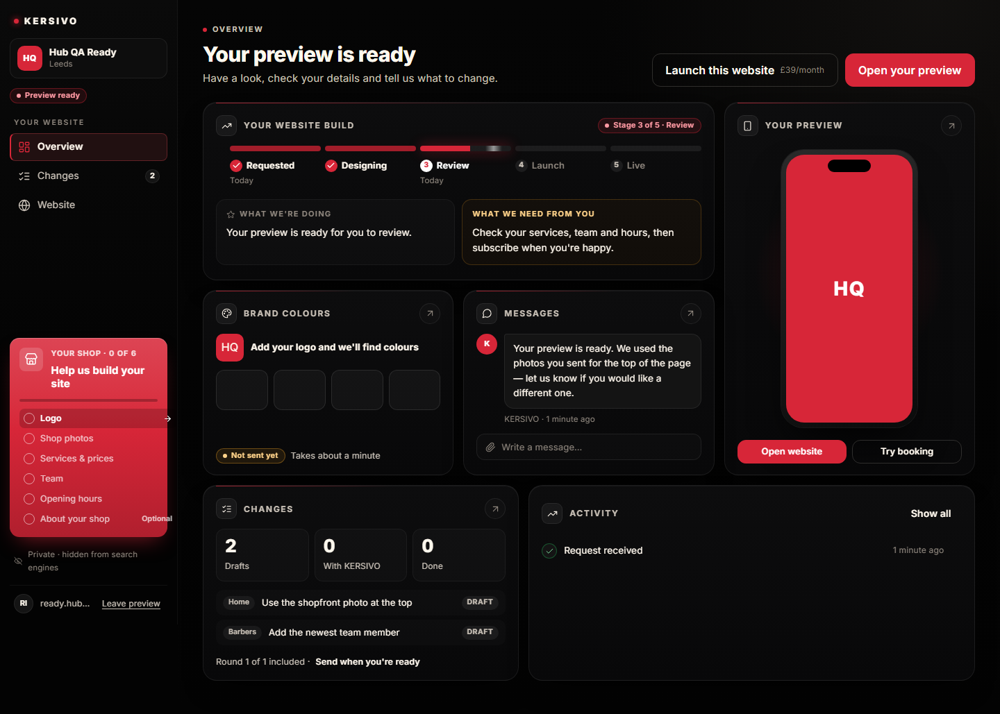
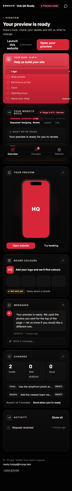
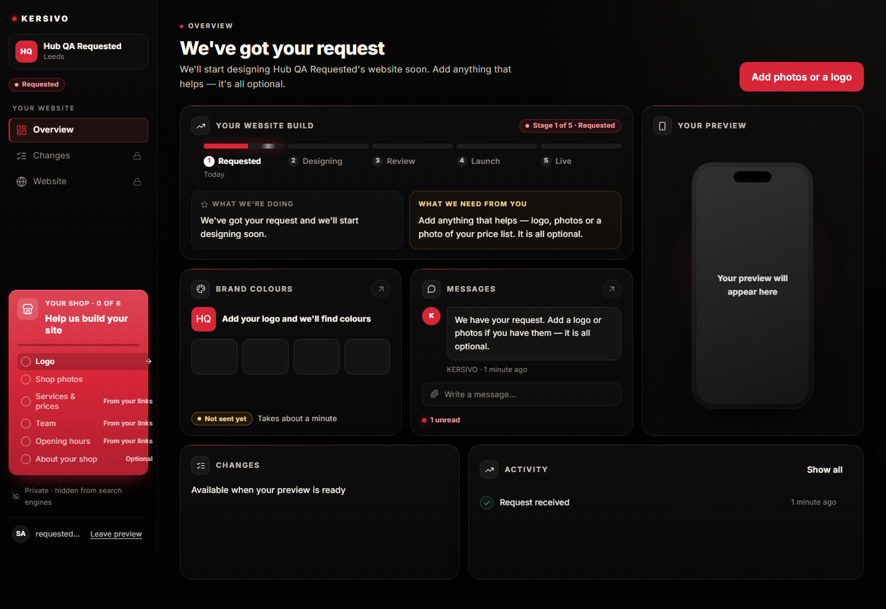
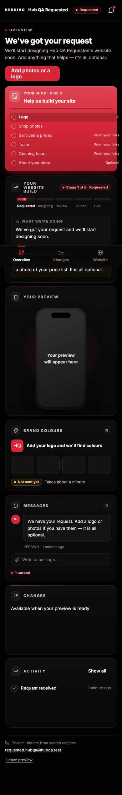
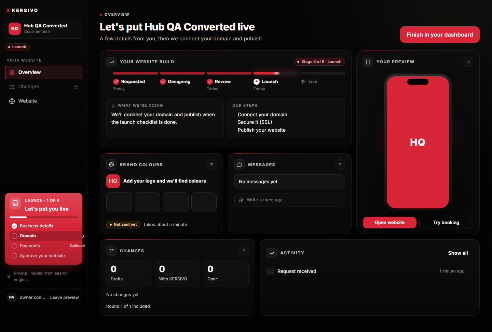
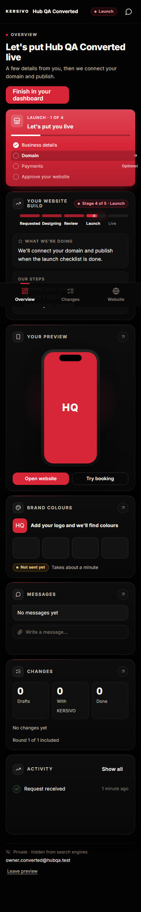
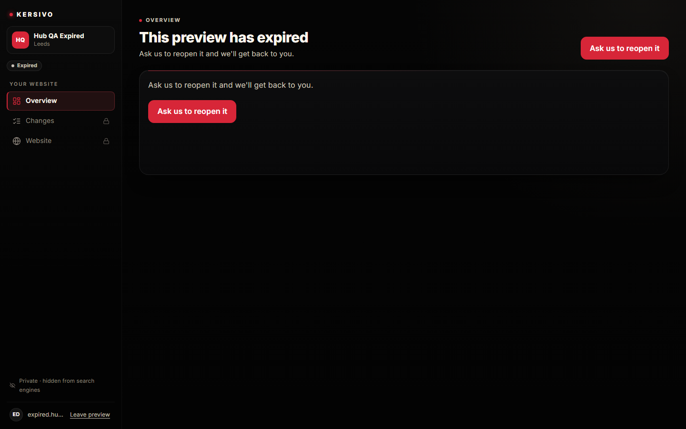
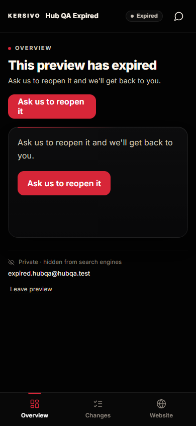
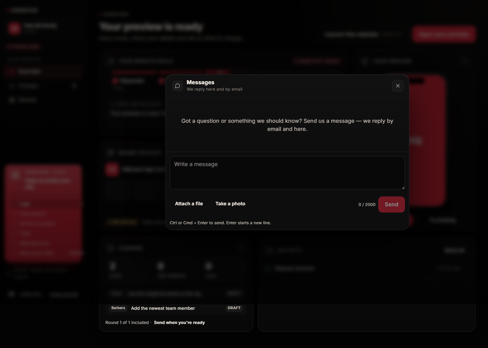

# Admin Hub — Batch 3 report (Overview bento)

Plan: [`BATCH_3_PLAN.md`](./BATCH_3_PLAN.md). Branch `admin-hub-batch-3`, PR base `admin-hub-batch-2`.

## Outcome

`/admin` Overview is now the bento in spec §4 / mockups 01 (desktop) and 04 (mobile). Tiles use the starter-card DNA (radius 20, `#0D0D0E → #080809`, 1px `rgba(255,255,255,.08)`, inset highlight, deep shadow, 1px red→transparent top line). Linkable tiles are a single `<a href>` (colours, messages, changes when unlocked). Progress and activity are not whole-tile links. Preview is an `<article>` with a stretched hit to `?section=website` and sibling “Open website” / “Try booking” — no nested `<a>`, no iframe.

`HubOverview.astro` is unchanged (flag-off `/preview/{token}` path). `ADMIN_HUB_ENABLED` stays off on Vercel. `PREVIEW_HUB_ENABLED` is not set. No migration.

Header: one primary from `HUB_PRIMARY` plus outline “Launch this website £39/month” (`PreviewTopBar` `chrome="checkout-outline"`). Desktop right; mobile 2-up under the header. The old stacked Review red button is not used in `/admin`.

Stage variants: Requested/Designing lock preview + changes; Launch right box is *Our steps*; Expired/Declined replace the bento with the calm full-width card (HUB_SPEC §9.2).

Messages open `?app=messages` as a 720px window / full sheet (`HubMessages` `chrome="app"`, sticky composer). Colours open `?app=colours` (still the logo app until Batch 4).

## Checks

| Check | Result |
| --- | --- |
| `npm test` | 5938 passed (the known `financialEndpoints` MANAGER timeout flaked once in the full run; 25/25 alone) |
| `npm run typecheck` | 0 errors |
| `npm run claims:check` | pass |
| `npm run build` | pass |
| `npm run test:admin-hub-real` | 15/15 Playwright tests + flag-off check. Axe (serious/critical) clean on Overview at 390 / 768 / 1440 for Requested, Ready and Expired. |

## Lighthouse (mobile, seeded Ready Overview)

Script: `scripts/admin-hub/lighthouse-overview.mjs`. Ran against the QA `astro dev` server on `http://127.0.0.1:4397/admin` with the `ks_hub` cookie. Summary: `docs/admin-hub/screens/batch-3/lighthouse-overview-mobile-summary.json`.

| | Score | Threshold |
| --- | --- | --- |
| Performance | **55** | ≥ 90 |
| Accessibility | **100** | ≥ 95 |
| CLS | **0.0002** | < 0.05 |

Accessibility and CLS pass. Performance on unminified `astro dev` does **not** meet ≥ 90 — same pattern as Shop Hub Batch 7 Overview (55 / 100 / 0.0002). Top opportunities were minify JS, text compression, and unused JS (Vite). Reserved tile `min-height`s are doing their job (CLS well under 0.05). Re-run on a production-like preview if a ≥ 90 claim is required; do not turn the flag on for that.

## Screenshots vs mockups

All in `docs/admin-hub/screens/batch-3/`. Captures are full-page.

### Ready Overview — desktop (mockup 01)

| Batch 3 (1440) | Mockup 01 |
| --- | --- |
|  |  |

Also: `ready-overview-1280.png` (12-col ≥1280), `ready-overview-768.png` (6-col).

### Ready Overview — mobile (mockup 04)

| Batch 3 (390) | Mockup 04 |
| --- | --- |
|  |  |

Order on mobile: header → 2-up actions → red setup card → progress → preview → colours → messages → changes → activity.

### Requested (locked preview + changes)

| 1440 | 390 |
| --- | --- |
|  |  |

Also: `requested-overview-{768,1280}.png`. Preview: “Your preview will appear here”. Changes: “Available when your preview is ready”. Messages tile shows **1 unread**.

### Launch (Our steps)

| 1440 | 390 |
| --- | --- |
|  |  |

Progress right box is *Our steps* (domain, SSL, publish).

### Expired (calm card)

| 1440 | 390 |
| --- | --- |
|  |  |

Bento is replaced. Header + card both carry “Ask us to reopen it”.

### Messages app (restyle; mockup 08)

| Batch 3 (1440) | Mockup 08 |
| --- | --- |
|  |  |

Also: `ready-messages-390.png` (full sheet).

## Differences from mockup

1. **Brand colours.** No extraction until Batch 4. Tile shows stored Main/Accent if present, otherwise four empty swatches and “Add your logo and we'll find colours”. Status is always “Not sent yet”. No “N colours found in your logo”, no invented hexes.
2. **Your preview thumbnail.** There is no server-screenshot field on the request. The phone is a CSS composition (logo or shop initials on the brand colour). No iframe, no “Northgate” site copy, no services list inside the phone.
3. **Progress copy** comes from HUB_SPEC §9.2, not the mockup’s Northgate lines. Same-day seed dates render as “Today”.
4. **Activity** lists real events only. The QA Ready shop has “Request received” — not the mockup’s four invented rows.
5. **Setup card** is 0 of 6 on the QA shops (no logo/photos uploaded) vs the mockup’s 2 of 6. Same Batch 2 card.
6. **Header actions.** Desktop matches (outline Launch + primary Open your preview). Mobile 2-up keeps that order (outline then primary); mockup 04 puts the primary on the left.
7. **Messages window** reuses `HubMessages` (attach, take a photo, 2000-character counter, sticky composer). The mockup is a slimmer chat with a paper-plane send. Tile composer is a static hint, not an input.
8. **Changes** counters and two latest drafts match the seed (Home / Barbers), not the mockup’s “Add Kyle”.
9. Mobile full-page shots include the fixed tab bar at the viewport bottom, so it appears mid-image.

## Open questions

1. **Lighthouse ≥ 90 on seeded data.** Measured 55 / 100 / CLS 0.0002 on QA `astro dev`. Confirm whether the ≥ 90 bar is fixture HTML (Batch 6 method), Vercel preview, or a local `astro preview`. I did not turn the flag on.
2. **Colours tile vs mockup 01.** Cannot match the four extracted swatches until Batch 4. The tile is honest about that.
3. **Batch 2 questions** (launch API flag, cookie-only / operator launch, operator precedence, converted-owner hub, `/admin` headers, expired 200) still stand.

## Files

New: `src/lib/adminHub/overview.ts` (+ test), `src/components/adminHub/AdminHubOverview.astro` (+ source test), `scripts/admin-hub/lighthouse-overview.mjs`, this report and `docs/admin-hub/screens/batch-3/`.

Changed: `hub.astro` (render `AdminHubOverview`, `showMobileSetup={false}` so the card sits under the header actions), `hubView.ts` (latest message + change items on Overview), `hubMessages.ts` (`loadLatestHubMessage`), `copy.ts`, `admin-hub.css` (tile DNA, 12/6/1 grid, reserved heights, messages-app chrome), `PreviewTopBar` (`checkout-outline`), `HubMessages` + `MessagesApp` (`chrome="app"`), `lucide-react.tsx` (tile icons), QA seed (KERSIVO message on Requested + Ready; two draft changes on Ready), Playwright.
