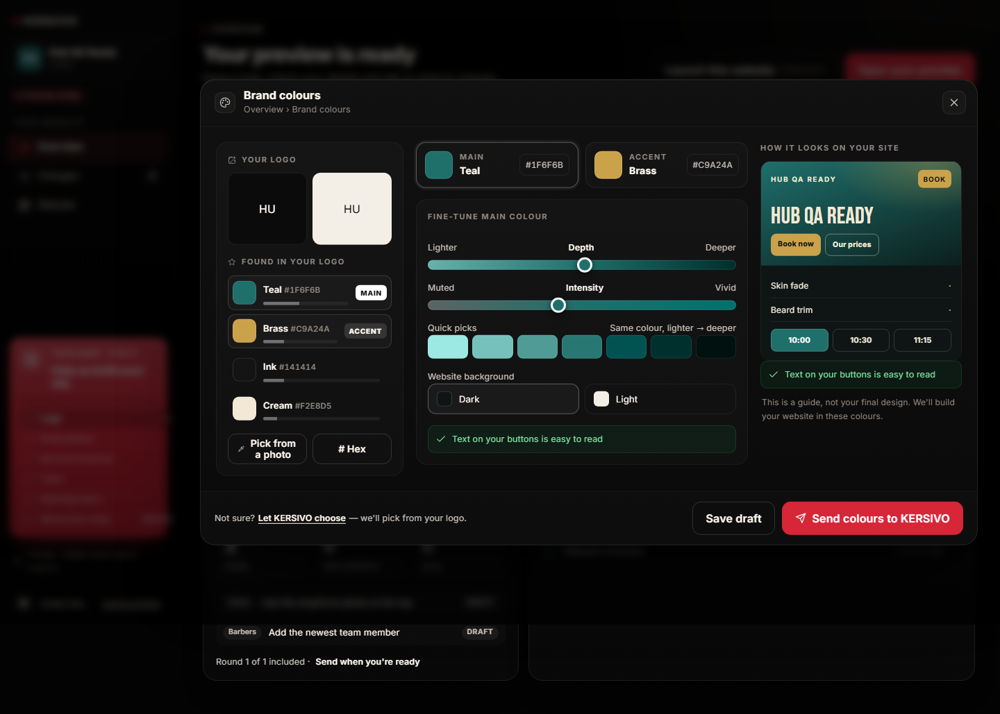
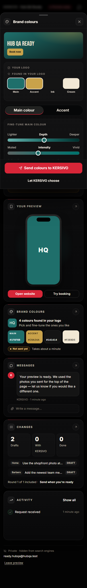
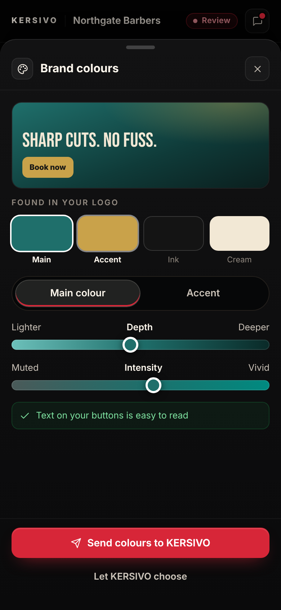

# Admin Hub — Batch 4 report (Brand colours)

Plan: [`BATCH_4_PLAN.md`](./BATCH_4_PLAN.md). Branch `admin-hub-batch-4`, PR base `admin-hub-batch-3`.

## Outcome

The Brand colours app is live behind `ADMIN_HUB_ENABLED` (still off on Vercel). Desktop is the three-column picker in spec §7 / mockup 02; mobile is the stacked sheet in mockup 07. Extraction runs in a Web Worker on the stored logo thumbnail (SVG/PDF → server-rasterised PNG). Roles, Depth/Intensity sliders (hue locked), hex, EyeDropper where supported, Dark/Light background, live mini-site and contrast auto-fix are all in. Footer: “Let KERSIVO choose” · Save draft · Send colours to KERSIVO.

`PREVIEW_HUB_ENABLED` is not touched. The old `/preview` colour chips in `HubYourShop` are unchanged. Existing Starter / direct-subscribe / paid shops without a preview request still see today’s admin (flag-off 404s on `/api/admin-hub/brand-colours`). Migration is additive only: four nullable columns.

Overview tile now opens this app and shows **Not sent yet** / **Sent** / **Using KERSIVO's choice**. Ops Overview (flag on) shows swatches with hex, role, source, tone, sent time and copy-to-clipboard per hex.

QA shops have no uploaded logo in blob storage. The Ready shop is seeded with a four-colour palette so screenshots are honest. Extraction is covered by fixtures + a canvas-mocked worker test.

## Checks

| Check | Result |
| --- | --- |
| `npm test` | 5985 passed; known `financialEndpoints` MANAGER 403 flaked once in the full run; 25/25 alone |
| `npm run typecheck` | 0 errors |
| `npm run claims:check` | pass |
| `npm run build` | pass |
| `npm run test:admin-hub-real` | 17/17 Playwright tests + flag-off check. Axe (serious/critical) clean on Brand colours at 390 and 1440. |

## Screenshots vs mockups

All in `docs/admin-hub/screens/batch-4/`. Captures are full-page.

### Brand colours — desktop (mockup 02)

| Batch 4 (1440) | Mockup 02 |
| --- | --- |
|  |  |

Also: `ready-colours-1280.png`, `ready-colours-768.png`.

### Brand colours — mobile (mockup 07)

| Batch 4 (390) | Mockup 07 |
| --- | --- |
|  |  |

### Overview tile (Ready)

The colours tile on Overview now uses the extracted count and **Not sent yet**. After Send it becomes **Sent**.

### Ops Overview

`ops-overview-colours-1440.png` and `ops-overview-colours-390.png` — swatches, hex, role, source, tone, sent time, Copy.

## Differences from mockup

1. **Shop name.** Mockups use “Northgate Barbers”. The app uses the real request name (QA: **Hub QA Ready**). Live preview services are the seeded Skin fade / Beard trim — no invented slogan or prices.
2. **Logo tiles.** QA has no stored logo, so the dark/light tiles show initials (`HU`) instead of a mark. Extraction still runs when a logo thumbnail exists.
3. **EyeDropper.** “Pick from a photo” is hidden where `window.EyeDropper` is missing (Firefox, Safari). Chromium shows it.
4. **Ink naming.** Spec says near-black at L < 0.18. `#141414` measures OKLab L ≈ 0.191, so the table uses L < 0.20 so the mockup’s Ink label still appears.
5. **Hue table.** Teal extends to hue < 205 and Brass to < 95 so `#1F6F6B` / `#C9A24A` match the mockup names (otherwise they were Blue / Olive).
6. **Mobile.** Matches mockup 07: preview first, swatch row, Main/Accent segmented control, sliders, sticky Send + Let KERSIVO choose. Hex, quick picks, tone toggle and Save draft stay desktop-only, as in the fixture HTML.
7. **Footer copy** is the spec sentence with “Let KERSIVO choose” as the link, not a plain `<a href="#">`.
8. **Mobile full-page shot** includes the Overview bento under the sheet (same as Batch 3 messages). The sheet itself matches mockup 07: preview, swatch row, Main/Accent, sliders, sticky Send.
9. **Ops Overview** is the existing request workspace, not a mockup. After the Playwright send it shows Ink as Accent, source From your logo, Dark, and a sent time.

## Open questions

1. **Ink threshold.** Keep L < 0.20 so `#141414` is Ink, or stick to the spec’s 0.18 and accept Charcoal for that mockup swatch?
2. **Batch 3 Lighthouse ≥ 90** on `astro dev` is still 55 / 100. Not re-measured this batch; flag stays off.

## Files

New
- `src/lib/adminHub/colour/` — sRGB↔linear↔OKLab↔OKLCH, ΔE_OK, gamut clamp, WCAG, k-means++ (seed 0x4B455253, ≤12 iters), merge, naming, roles, worker.
- `src/lib/adminHub/brandColours.ts` — zod + save (draft / send / KERSIVO chooses).
- `src/lib/previewHub/handlers/brandColours.ts` + `/api/admin-hub/brand-colours` + token twin.
- `src/components/adminHub/apps/ColoursApp.tsx` — three-column / stacked sheet UI.
- `src/components/ops/previewRequests/OpsBrandColours.tsx` — ops Overview swatches + copy.
- `prisma/migrations/20261031260000_admin_hub_brand_colours/` — four nullable columns.
- this report and `docs/admin-hub/screens/batch-4/`.

Changed
- Prisma `PreviewRequest` + `previewAccess` select + anonymise.
- App registry (`apps.ts`, `loadApp.ts`, AppHost Palette + chrome footer).
- Overview tile (extracted count, sent / KERSIVO status).
- Ops request workspace Overview (flag-gated).
- Activity label `You sent your colours` + `FUNNEL_EVENTS.hub_brand_colours_sent`.
- QA seed (palette + Main/Accent/tone/source on the Ready shop; no Northgate copy).
- Playwright batch 4.
