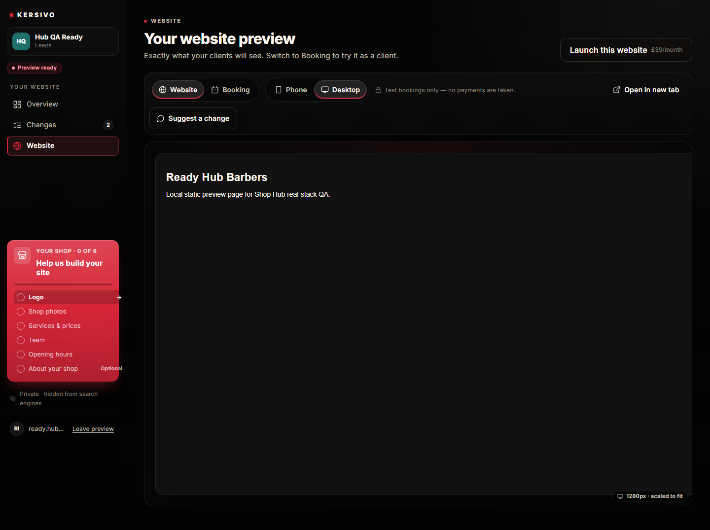
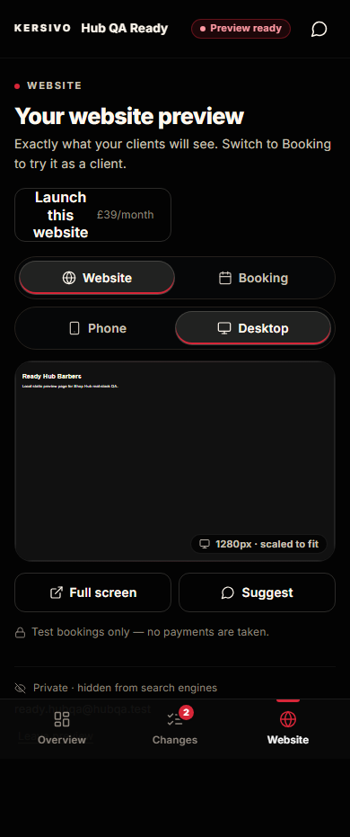

# Admin Hub — Batch 5 report (Website + Changes)

Plan: [`BATCH_5_PLAN.md`](./BATCH_5_PLAN.md). Branch `admin-hub-batch-5`, PR base `admin-hub-batch-4`.

## Outcome

Website and Changes now render in the new hub shell behind `ADMIN_HUB_ENABLED` (still off on Vercel). The calculator `.calc-segmented` pill is a shared `SegmentedControl` (Astro + React + shared CSS). The Website toolbar uses it for Website|Booking (links) and Phone|Desktop (native radios). Desktop previews render at 1280×800 (1440×900 when the stage is wider than 1440) and scale with `transform`; Phone is 390×844, scaled only when the stage is narrower. Device choice defaults by width (≥1024 desktop) and is remembered in `localStorage` (`ks_admin_hub_website_device`, try/catch). Launch sits in the page header as outline. Changes keeps the existing `HubChanges` logic, opens the composer as an app sheet, and has a sticky “Send changes to KERSIVO” footer. Locked before Review.

`PREVIEW_HUB_ENABLED` is not touched. No migration. Flag-off `/preview` still uses `HubWebsiteView` / `HubChanges`. Pin mode is still not shipped.

## Checks

| Check | Result |
| --- | --- |
| `npm test` | 6000 passed; known `financialEndpoints` MANAGER 403 timed out once in the full run; 25/25 alone |
| `npm run typecheck` | 0 errors |
| `npm run claims:check` | pass |
| `npm run build` | pass |
| `npm run test:admin-hub-real` | 23/23 Playwright + flag-off check. Axe (serious/critical) clean on Website and Changes at 390 and 1440. Device toggle, Booking stage, Changes sheet, locked states, calculator extract and keyboard all covered. |

## Screenshots vs mockups

All in `docs/admin-hub/screens/batch-5/`. Captures are full-page unless noted.

### Website desktop (mockup 03)

| Batch 5 (1440, desktop device) | Mockup 03 |
| --- | --- |
|  |  |

Also: `ready-website-desktop-768.png`. Phone device on a wide screen: `ready-website-phone-1440.png`.

### Website desktop-mode on a phone (mockup 05)

| Batch 5 (390, desktop device) | Mockup 05 |
| --- | --- |
|  |  |

Also: `ready-website-desktop-360.png`. Phone device: `ready-website-phone-360.png`, `ready-website-phone-390.png`, `ready-website-phone-768.png`.

### Booking stage

`ready-booking-390.png`, `ready-booking-1440.png` — same scaled stage, Booking pill current.

### Changes

`ready-changes-390.png`, `ready-changes-1440.png` — counters, page + status chips, sticky send. Composer sheet is covered by the Playwright open/Esc assertion (`admin-hub-suggest`).

### Locked before Review

`requested-website-locked-390.png` / `1440.png` and `requested-changes-locked-390.png` / `1440.png`.

### Calculator extract (before = live kersivo.co.uk, after = this branch)

Full page: `calc-before-390.png`, `calc-after-390.png`, `calc-before-1440.png`, `calc-after-1440.png`. Cropped period pills: `calc-before-pills-*.png`, `calc-after-pills-*.png` (written when the live control is visible).

## Differences from mockup

1. **Shop name.** Mockups use “Northgate Barbers”. The app uses the real request name (QA: **Hub QA Ready**). No invented slogan, prices or “northgatebarbers.co.uk” browser chrome.
2. **Preview document.** QA iframe is the seeded stub (“Ready Hub Barbers” / local static preview). The mockup’s “Sharp cuts. No fuss.” site is mock data and is not shipped.
3. **No decorative laptop/browser frame.** Spec §8 asks for a scaled iframe and the “1280px · scaled to fit” badge, not traffic-light chrome or a fake URL bar.
4. **Pin hint.** Mockup 03 shows “Click anything on the page to suggest a change”. Pin mode stays conditional and unshipped (spec §8 last bullet).
5. **Launch on mobile.** Spec moves Launch to the page header as outline. Mockup 05 omits it; we keep the spec.
6. **Toolbar wrap.** Calculator pill min-sizes are larger than the mockup’s `.seg`. Hub toolbar options are tightened to 38px / 13px padding so Website|Booking and Phone|Desktop stay compact; “Suggest a change” can still wrap under “Open in new tab” when the note is long.
7. **Booking** is the real `BookingFlow` wizard in the scaled frame, not a marketing mock. Hub-scoped eyebrow colour `#e84555` (brand red on `#080809` is 4.02:1 at 12px).
8. **Changes** has no dedicated mockup. Layout follows §9: header, counters, chips, sticky send, composer as an app sheet.

## Open questions

1. **Browser chrome.** Add a non-interactive traffic-light / URL bar around the iframe to match mockup 03, or keep the spec’s plain scaled frame?
2. **Pin mode** remains for a later batch (HUB_SPEC §10).
3. **Batch 3 Lighthouse ≥ 90** on `astro dev` is still outstanding. Not re-measured this batch; flag stays off.

## Files

New
- `src/styles/components/segmented-control.css`
- `src/components/ui/SegmentedControl.astro` + `.tsx` + unit test
- `src/lib/adminHub/previewStage.ts` + scale-maths test (360, 390, 768, 1024, 1280, 1600)
- `src/components/previewHub/useHubChanges.ts` + `HubChangeComposer.tsx`
- `src/components/adminHub/AdminHubWebsite.tsx` + `AdminHubChanges.tsx` + `AdminHubSheet.tsx` + tests
- this report and `docs/admin-hub/screens/batch-5/`

Changed
- `CostCalcPanel.astro` / `CostResults.astro` — Astro SegmentedControl; `data-calc-period` + `name=period` kept
- `barber-cost-calculator-tool.css` — imports the shared pill CSS
- `src/pages/admin/hub.astro` — Website / Changes / locked
- `admin-hub.css` — toolbar, scaled stage, changes list, sticky send, mobile stack + 2-up
- `src/lib/adminHub/copy.ts` — Website / Changes chrome
- `PreviewTopBar.tsx` — `data-astro-reload` on Terms / DPA so the island hydrates
- `HubChanges.tsx` — thin wrapper over the extracted hook + composer
- `scripts/admin-hub-real.spec.ts` — batch 5 shots, axe, device, keyboard, calculator before/after
- client-safe / page tests updated for the new islands

Not touched
- `PREVIEW_HUB_ENABLED`, Vercel flags, `HubWebsiteView`, pin mode, migrations, `ks_hub` cookie
