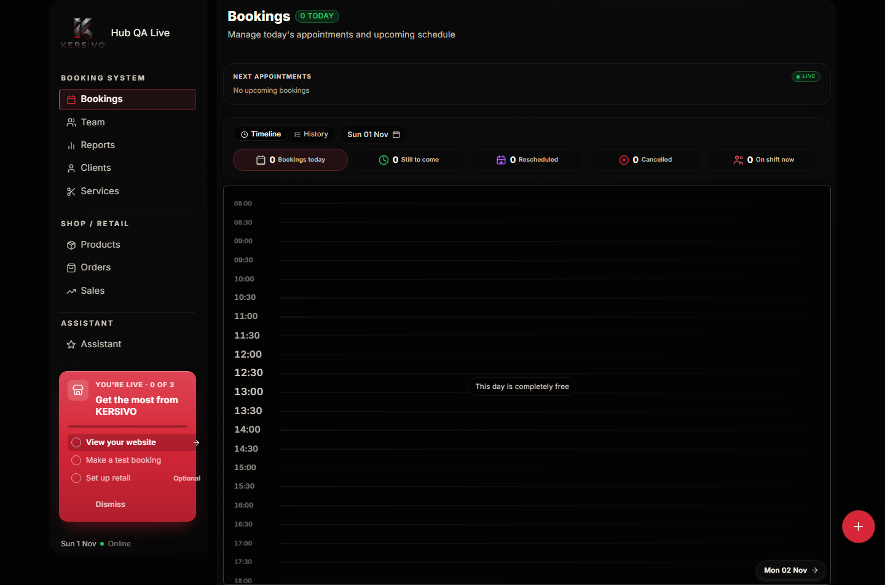
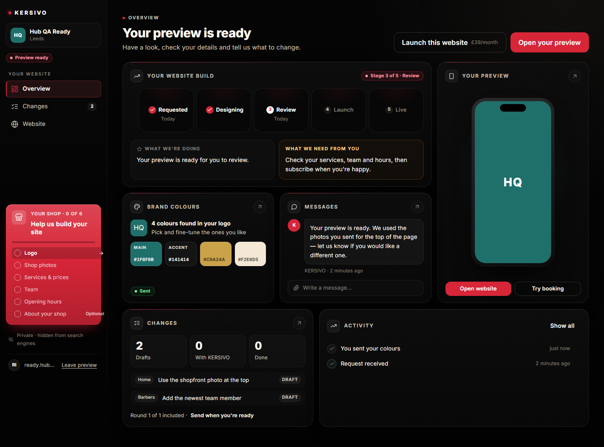
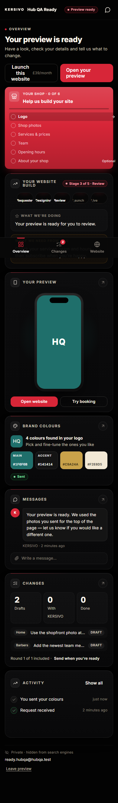

# Admin Hub — Batch 6 report (Phase 3 card, real-stack QA, production switch)

Plan: [`BATCH_6_PLAN.md`](./BATCH_6_PLAN.md). Branch `admin-hub-batch-6`, PR base `admin-hub-batch-5`.

## Outcome

Phase 3 of the red setup card is in the **full admin** for shops that came through a preview and are live. Status **You're live · n of 3** (CSS uppercase matches the mockup) / title **Get the most from KERSIVO**. Rows:

1. **View your website** — opens the live site in a new tab and POSTs `/api/admin/next-steps/view-site` (stores `nextStepsWebsiteViewedAt`).
2. **Make a test booking** — `/admin/test-book`. Done when a booking on the shop has notes starting with `[TEST]` (the existing owner test-booking prefix). No new `testBookingCompletedAt` column.
3. **Set up retail** — Optional; `/admin/retail-onboarding`. Done only when `retailOnboardingCompleted` is true (skip does not count).

The card hides when all three are done or after **Dismiss** (`nextStepsDismissedAt`). It replaces today's "paid → hide CTA" **only** for these live preview shops. Starter still sees the current launch CTA; paid-direct shops without a preview still see no card.

`ADMIN_HUB_ENABLED` stays off on Vercel. Owner hub emails, ops hub APIs and launch-steps treat `isAnyHubEnabled()` (`PREVIEW_HUB_ENABLED` **or** `ADMIN_HUB_ENABLED`) so production can turn on only the admin hub. `PREVIEW_HUB_ENABLED` is not touched.

Additive migration only: `ShopSettings.nextStepsDismissedAt`, `nextStepsWebsiteViewedAt`.

## Checks

| Check | Result |
| --- | --- |
| `npm test` | 6012 passed; known `financialEndpoints` MANAGER 403 timed out once in the full run; 25/25 alone |
| `npm run typecheck` | 0 errors |
| `npm run claims:check` | pass |
| `npm run build` | pass |
| `npm run test:admin-hub-real` | **28/28** Playwright + flag-off check (`/preview` does not bridge, `/admin` has no hub shell, `/admin/hub` 404). |

Real-stack journey covered: request → email "Open your shop hub" → `/admin` Requested → logo + photo upload → colours / message → ops sees files and replies → READY bento + Website desktop-on-phone + confirm services + draft + send changes → checkout stub (400 on the already-ready shop is accepted) → owner login → Launch card → approve → ops marks live → full admin Phase 3 → view site + test booking → **You're live · 2 of 3**.

Negatives: rejected / unknown token 404 (indistinguishable), tampered `ks_hub` drops hub mode, cookie-only hits on `/api/admin/bookings`, `/api/admin/clients`, `/api/admin/next-steps/dismiss` and `/api/setup/launch-context` return 401/403/404/405.

## Old Batch 7 part C — already on this branch

All six hardening items were already on `main` via preview-hub Batch 7 (`7ddae1c1`). Not re-implemented.

| Item | Already on main | Where |
| --- | --- | --- |
| 1. Retention of never-ready requests (REQUESTED / IN_PROGRESS, no activity 180 days → EXPIRED, no email) | Yes | `lifecycle.ts` `PREVIEW_STALE_OPEN_DAYS`, `lifecycle.test.ts` |
| 2. Orphan `MESSAGE_ATTACHMENT` / `CHANGE_ATTACHMENT` after 24 hours | Yes | `purgeOrphanHubAttachments`, `lifecycle.test.ts` |
| 3. Review Apply in one Prisma `$transaction` | Yes | `hubReviews.ts`, `hubReviews.apply.test.ts` |
| 4. Real body-size cap (`readLimitedHubBody` counts bytes, not only `Content-Length`) | Yes | `hubApi.ts`, `hubApi.body.test.ts` |
| 5. SVG sanitising (`<script`, `on*`, `<foreignObject`, external href) | Yes | `hubAssets.ts`, `hubAssets.test.ts` |
| 6. Payment on a rejected request → warning + internal email, no owner-facing change | Yes | `conversion.ts`, `emails.ts`, `conversion.test.ts` |

## Screenshots vs mockups

All in `docs/admin-hub/screens/batch-6/`. Captures are full-page at **360, 390, 768, 1280, 1440** unless noted.

### Phase 3 card — full admin (mockup 06, card 3)

| Batch 6 (1440, 0 of 3) | Mockup 06 |
| --- | --- |
|  |  |

Also: `live-phase3-360.png`, `live-phase3-390.png`, `live-phase3-768.png`, `live-phase3-1280.png`. After view-site + test booking: `live-phase3-2of3-1440.png`. After the live journey: `journey-live-admin-*.png`, `screen-live-admin-*.png`.

### Overview — Review (mockups 01 / 04)

| Batch 6 (1440) | Mockup 01 |
| --- | --- |
|  |  |

| Batch 6 (390) | Mockup 04 |
| --- | --- |
|  |  |

Also: `screen-overview-360.png`, `768`, `1280`. Journey copies: `journey-ready-overview-*`, `journey-requested-*`.

### Website (mockups 03 / 05)

`screen-website-*` plus `journey-website-desktop-phone-360.png` / `390.png` (desktop device on a phone).

### Brand colours (mockups 02 / 07)

`app-colours-1440.png` / `app-colours-390.png` (and 360 / 768 / 1280).

### Messages (mockup 08)

`app-messages-*`.

### Other hub screens and apps

Every app at all five widths: `app-logo`, `app-photos`, `app-services`, `app-team`, `app-hours`, `app-about`, `app-colours`, `app-messages`, `app-activity`, `app-setup`. Sections: `screen-changes`, `screen-requested`, `screen-expired`, `screen-launch`. Regression: `starter-cta-1440.png`, `paid-direct-1440.png`.

## Differences from mockup

1. **Shop name.** Mockups use “Northgate Barbers”. QA uses **Hub QA Ready** / **Hub QA Live** / **Hub QA Converted**. No invented slogan or “northgatebarbers.co.uk”.
2. **Phase 3 icon.** Mockup 06 uses a sparkle. The card reuses the existing conversion CTA store icon so it stays in the same family as today's sidebar button.
3. **Title wrap.** “Get the most from KERSIVO” wraps onto two lines in the 256px sidebar. The mockup card is wider and stays on one line.
4. **Dismiss.** Spec §5 requires Dismiss; mockup 06 omits it. We keep the spec.
5. **0 of 3 vs 1 of 3.** The isolated Phase 3 capture is the first visit (nothing marked). Mockup 06 shows website already done. `live-phase3-2of3-1440.png` is the post-journey state (website + test booking done; retail next).
6. **Preview tile.** QA phone frame is a CSS composition with initials on the brand colour, not a photographed iPhone or a designed marketing site.
7. **Full admin chrome.** Phase 3 sits in today's bookings sidebar (Bookings, Team, Reports…). The mockup is a card on black only.

## Lighthouse (mobile, astro dev)

Measured with `scripts/admin-hub/lighthouse-batch-6.mjs` against the real-stack QA server (`http://127.0.0.1:4397`), cookie from the Ready token. Raw: `docs/admin-hub/screens/batch-6/lighthouse-mobile-summary.json`.

| Screen | Performance | Accessibility | CLS |
| --- | --- | --- | --- |
| `/admin` Overview | 50 | 100 | 0.162 |
| `/admin?section=website` | 54 | 100 | 0.00003 |

These are **astro-dev** numbers (no minify, Vite overlay, islands hydrating). Spec §10 asks for ≥ 90 performance, ≥ 95 accessibility, CLS < 0.05 on the hub. Accessibility passes. Performance and Overview CLS do not meet the bar on this server — same situation as Batches 3–5. Not a reason to turn the flag on until a production (or Vercel preview) Lighthouse pass.

## Production switch — not done in this PR

Per the batch rules: **do not merge**, **do not set `ADMIN_HUB_ENABLED` on Vercel** until this PR is merged and a READY production deployment exists.

After the founder merges and production is green:

1. Vercel → project `kersivo-barber-outreach` → **Settings → Environment Variables**.
2. Add `ADMIN_HUB_ENABLED=true` for **Production only** (not Preview, not Development).
3. Do **not** set or change `PREVIEW_HUB_ENABLED`.
4. Redeploy Production.
5. Smoke on kersivo.co.uk with the **founder's email** (ask; do not invent one): request “KERSIVO Test Shop” → email link → `/admin` hub → upload logo → send colours → message → ops reply → headers (`noindex`, `no-referrer`, `private`) → no runtime errors → reject the test request.
6. If any step fails: unset the flag, redeploy, report with logs.

I do not have Vercel CLI access in this session and will not set the flag.

## Open questions

1. **Founder email** for the production smoke (do not invent one).
2. **Lighthouse ≥ 90** on a production or Vercel preview build of `/admin` hub Overview — still outstanding on astro dev.
3. **Phase 3 title wrap** in the 256px sidebar — leave as-is, or shorten the title?

## Files

New
- Additive migration `prisma/migrations/20261101010000_admin_hub_next_steps/`
- `src/lib/adminHub/nextSteps.ts` + unit test
- `src/pages/api/admin/next-steps/view-site.ts`, `dismiss.ts` + tests
- `src/components/admin/AdminNextStepsCard.tsx`
- `scripts/admin-hub/lighthouse-batch-6.mjs`
- this report, `BATCH_6_PLAN.md`, `docs/admin-hub/screens/batch-6/`

Changed
- `ShopSettings` + `setupCard.ts` Phase 3 hrefs and status
- `AdminSidebarLaunchCta` / `AdminLayout` (mobile placement) / `launch-context` — Phase 3 instead of hide, only for live preview shops
- Hub emails + ops APIs + lifecycle digests: `isAnyHubEnabled()`
- Seed: live / paid-direct / Starter shops; booking cleanup; converted shop paid + onboarded
- `scripts/admin-hub-real.spec.ts` — Phase 3, journey, negatives, screenshot catalogue
- QA-only `POST /api/preview-hub-qa/test-booking` (404 unless `PREVIEW_HUB_REAL_QA`)

Not touched
- `PREVIEW_HUB_ENABLED` on Vercel
- Old `/preview/{token}` hub pages
- Production env
